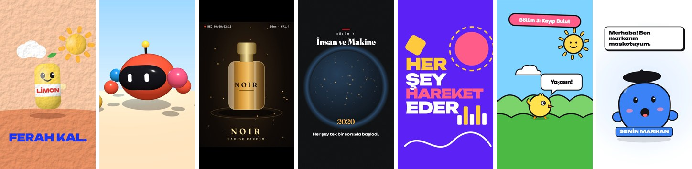

# Claude Stüdyo

Claude Code için 7 skill. Her biri bir ekibin işini yapıyor ve sonucu kodla çiziyor: kil animasyon reklamdan 3D sahneye, belgesel girişinden konuşan maskota kadar. Çıktı tek bir HTML dosyası; tarayıcıda oynar, tek komutla MP4 olur.



| Skill | Ne yapar | Örnek |
|---|---|---|
| `kil-animasyon` | Hamur dokulu, stop-motion ürün reklamı | `ornekler/kil.html` |
| `3d-animasyon` | Parlak, yumuşak ışıklı 3D karakter sahnesi (Three.js) | `ornekler/3d.html` |
| `reklam-filmi` | Karanlık stüdyoda sinematik ürün reklamı | `ornekler/reklam-filmi.html` |
| `belgesel` | Film grenli, serif başlıklı belgesel girişi | `ornekler/belgesel.html` |
| `motion-grafik` | Kinetik yazı ve hareketli şekiller | `ornekler/motion.html` |
| `cizgi-film` | Kalın çizgili, paralaks manzaralı çizgi film sahnesi | `ornekler/cizgi-film.html` |
| `konusan-maskot` | Sese göre ağzını oynatan marka maskotu | `ornekler/maskot.html` |

Görüntü üretmek için ücretli bir yapay zekâ servisine gerek yok. Claude sahneyi SVG, CSS ve Three.js ile yazıyor, sen istediğin kadar düzelttiriyorsun.

## Gerekenler

- [Claude Code](https://claude.com/claude-code)
- Node.js 18 veya üstü
- MP4 için ffmpeg (macOS: `brew install ffmpeg`, Windows: `winget install ffmpeg`)

## Kurulum

```bash
git clone https://github.com/yapaytu/claude-studyo.git
cd claude-studyo
npm install
npx playwright install chromium
```

Git kullanmıyorsan GitHub sayfasındaki yeşil **Code** butonundan **Download ZIP** de.

## Kullanım

Klasörde `claude` yaz ve ne istediğini söyle:

```text
kil-animasyon skill'iyle limonata markam "Serin" için 6 saniyelik reklam yap.
```

```text
konusan-maskot skill'iyle kahve dükkânım için maskot tasarla, ses.mp3'e göre konuşsun.
```

Claude sahneyi `ciktilar/` klasörüne yazar ve MP4'ünü alır. Beğenmediğin yeri söyle, düzeltsin.

Önce örneklere bakmak istersen `ornekler/` içindeki dosyaları tarayıcıda aç. Birini MP4 yapmak için:

```bash
node araclar/kaydet.mjs ornekler/kil.html
```

## Skill'leri başka projede kullanmak

`.claude/skills/` içindeki klasörleri kendi projenin `.claude/skills/` klasörüne, `STUDYO.md` ve `araclar/` klasörünü de projenin köküne kopyala.

## Nasıl çalışıyor

Her sahne `window.ciz(kare)` fonksiyonu olan bir HTML sayfası. Önizlemede tarayıcı bu fonksiyonu saniyede 30 kez çağırıyor. `araclar/kaydet.mjs` ise sayfayı görünmez bir tarayıcıda açıp her kareyi tek tek çizdiriyor, fotoğrafını çekip ffmpeg ile videoya diziyor. Bu yüzden takılma, atlama ya da kare kaybı olmuyor. Kurallar `STUDYO.md` dosyasında.

---

[YapayTU](https://yapaytu.com) tarafından hazırlandı. MIT lisanslı.
